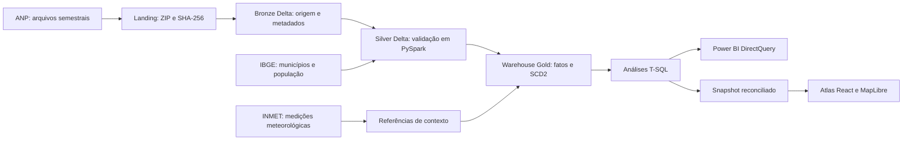
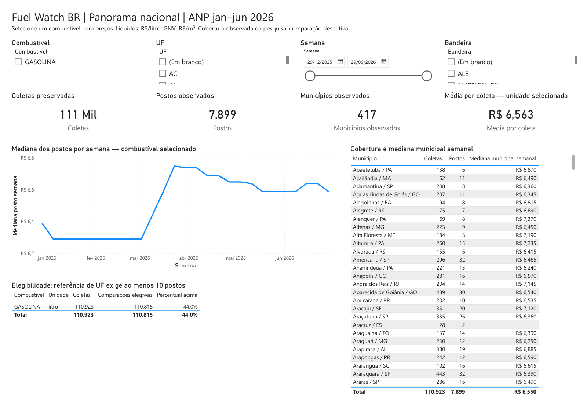

# Fuel Watch BR

**Engenharia de dados com Microsoft Fabric: da fonte pública à análise geográfica de preços.**

[Atlas interativo](https://victorhob.me/fuelwatch/) · [Apresentação do projeto](docs/portfolio.md) · [Demonstração técnica](docs/demo.md) · [Índice de evidências](evidence/README.md)

Projeto pessoal de estudo e portfólio voltado à engenharia de dados e à preparação para a DP-700. Integra preços de combustíveis da ANP, referências municipais/populacionais do IBGE e meteorologia do INMET, com transformação no Fabric e resultados verificáveis.

**Escopo concluído:** 12 marcos iniciais e cinco marcos de ampliação aceitos. O [registro de fechamento](docs/roadmap-fase2-cinco-marcos.md#fechamento-verificado-em-15112026) e o [manifesto de progresso](evidence/phase2/progress.json) preservam critérios e evidências.

## Resultado entregue

| Dimensão | Cobertura histórica |
| --- | --- |
| Período | Janeiro de 2024 a junho de 2026 |
| Coletas aceitas | 2.125.547 |
| Postos observados | 13.030 |
| Municípios / UFs | 462 / 27 |
| Combustíveis | Gasolina comum e aditivada, etanol, diesel comum e S10, GNV |
| Histórico dimensional | 15.005 versões observadas de posto |
| Agregações municipais | 252.391 grupos semana/produto/unidade |

O atlas permite explorar Brasil → estado → município, filtrar combustível e semana e consultar medianas e cobertura. A camada individual carrega postos sob demanda por UF e produto, com localização de um snapshot cadastral ANP. Os relatórios Power BI apresentam evolução, posição relativa, bandeiras, postos comuns entre períodos e contexto populacional/climático.

## Arquitetura



Pipelines parametrizados orquestram ingestão e transformação. A publicação relaciona versão de origem, execução e snapshot; o Warehouse protege a troca de dimensões e fatos com transação. Um laboratório separado usa Eventstream, Eventhouse, KQL e Activator com eventos sintéticos.

## Competências demonstradas

- **Ingestão e transformação:** Copy, notebooks PySpark, Dataflow Gen2, Delta e T-SQL, preservando a coleta individual antes das agregações.
- **Modelagem e temporalidade:** fato de preços, dimensões, SCD2 de atributos observados e comparação dos mesmos postos entre semestres.
- **Qualidade e rastreabilidade:** versões por conteúdo, duplicatas, conflitos, ausências e reconciliação integral com referência independente.
- **Operação:** repetição, correção de arquivo antigo, falha antes do commit, recuperação e agenda finita executada e encerrada.
- **Ciclo de vida:** Git, CI, promoção/restauração dev → test e reconstrução de dados e consumo em workspace vazio.
- **Desempenho:** experimento medido de materialização, com igualdade de conteúdo e limites registrados.

## Análises e consumo

A mediana regional parte da mediana semanal de cada posto, com um peso por estabelecimento. Comparações expõem tamanho da amostra e exigem cobertura mínima. A persistência considera somente semanas elegíveis; ausência de coleta permanece ausência. Bandeiras são comparadas em município/produto/semana comuns.



[Relatório histórico de quatro páginas em PDF](evidence/phase2/deployment/rebuild-history-report-qa4.pdf) · [Regras analíticas](docs/analytics-contract.md) · [Dados históricos](docs/dados-historicos.md) · [Contexto e interpretação](docs/context-answers.md)

## Evidências de confiabilidade

| Cenário executado | Evidência |
| --- | --- |
| Publicação histórica e reconciliação | [Warehouse reconstruído](evidence/phase2/deployment/rebuild-warehouse-history-rebuild01.json) |
| Falha antes do commit e publicação preservada | [Recibo de falha controlada](evidence/phase2/history/warehouse-fail_before_commit.json) |
| Correção histórica e reconstrução SCD2 | [Laboratório de correção](evidence/phase2/history/lab/fabric-correction.json) |
| Repetição integrada com publicação idêntica pulada | [Execução do pipeline reconstruído](evidence/phase2/deployment/rebuild-integrated-pipeline-0da4170c-054f-4702-807b-d3b8773a0c70.json) |
| Contexto sem multiplicar as coletas | [Join no Warehouse](evidence/phase2/context/warehouse-join.json) |
| CI executado no GitHub | [Recibo](evidence/phase2/deployment/github-ci.json) |
| Otimização com conteúdo reconciliado | [Medições antes/depois](evidence/phase2/performance/context-query.json) |

A verificação de fechamento registrou 89 testes locais do núcleo e dez de transporte/identidade. O CI executou o subconjunto de 47 testes portáveis e dez de transporte; essas contagens se sobrepõem. O workflow é manual, com runner local efêmero, e não executa código de pull requests automaticamente.

## Executar localmente

Python 3.13.5 foi o ambiente observado. A referência local valida contratos; a execução Fabric é demonstrada nos recibos próprios.

```powershell
python -m venv .venv
.venv/Scripts/python.exe -m pip install -r requirements-local.txt
.venv/Scripts/python.exe -m scripts.download_sources
.venv/Scripts/python.exe -m scripts.profile_sources
.venv/Scripts/python.exe -m scripts.prepare_local_slice
.venv/Scripts/python.exe -m unittest discover -s tests -v
```

Os comandos acima reproduzem a primeira fatia local RJ/gasolina/2026H1. Para a solução ampliada, consulte [histórico e operação](docs/history-operations.md) e [reconstrução no Fabric](docs/rebuild-phase2.md). Autenticação, bindings e recursos Fabric pertencem ao ambiente do executor e ficam fora do Git.

## Escopo e limites

- Preços históricos, nominais e amostrais; os municípios observados não representam cobertura de todos os postos brasileiros. GNV usa BRL/m³; os outros produtos usam BRL/litro.
- A localização individual do atlas vem do cadastro ANP consultado em 15/11/2026. Pode diferir do endereço histórico, tem cobertura parcial e é identificada como não validada pela ANP.
- SCD2 representa mudanças observadas, sem inferir a data jurídica de uma alteração. População e clima têm referência temporal, cobertura e limites explícitos.
- Streaming e correções injetadas são laboratórios sintéticos identificados. A revisão de segurança foi aceita por implementação/configuração; não houve teste com segunda identidade.
- O experimento de materialização mede uma consulta via TDS; não mede o ganho do pipeline inteiro nem economia de capacidade.
- O projeto foi executado na trial existente. Agendas e laboratórios foram encerrados após verificação; a demonstração estática independe de manter o Fabric ativo.

## Documentação e fontes

[Modelo de dados](docs/data-model.md) · [Contrato histórico](docs/history-contract.md) · [Implantação](docs/deployment.md) · [Segurança](docs/security-matrix.md) · [Consumo](docs/consumption.md) · [Roteiro de demonstração](docs/demo.md)

Fontes: [ANP — série histórica de preços](https://www.gov.br/anp/pt-br/centrais-de-conteudo/dados-abertos/serie-historica-de-precos-de-combustiveis), [IBGE — localidades](https://servicodados.ibge.gov.br/api/docs/localidades), [INMET](https://portal.inmet.gov.br/). Código e documentação são do projeto; as fontes mantêm sua autoria e condições de uso. Dados brutos, credenciais, caches de autenticação e bindings privados ficam fora do repositório.
