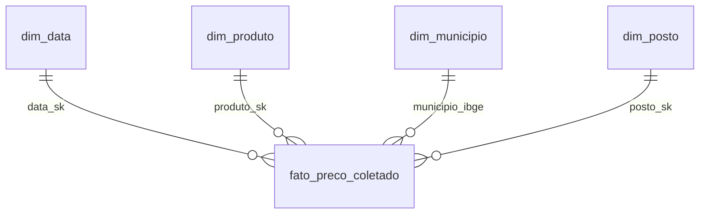

# M04 — Gold dimensional e histórico observado

**Estado em 12/11/2026: preparado; núcleo relacional testado localmente; nenhuma execução M04 no Fabric.** O M02 está aceito. M03 continua sendo pré-requisito para escolher e publicar a entrada oficial da Gold. Esta preparação não altera notebooks, regras ou evidências M02/M03.

## Decisões e verificações

| Decisão | Motivo | Como verificar |
| --- | --- | --- |
| Warehouse independente | As tabelas Gold precisam de DDL/DML T-SQL | Confirmar tipo do item no workspace; não confundir com SQL analytics endpoint |
| Primeiro usar schema `lab_m04` | Executar casos sintéticos sem alterar tabelas oficiais | Conferir schema de todos os scripts; não existe escrita em `gold` ou no Lakehouse |
| Uma coleta por CNPJ/produto/data/unidade | Preservar a granularidade validada na Silver | Zero chaves duplicadas e comparação bidirecional dos 13 campos de negócio |
| Preço `decimal(10,3)` e IQR preservado | Conservar precisão e preços apenas incomuns | 8.052 preços íntegros e 26 sinais no baseline local |
| Histórico por datas de observação | ANP informa atributos vistos na coleta, não a data jurídica da mudança | Fixture com início/fim explícitos e zero associação ambígua |
| Reconstruir o escopo completo inicialmente | Atrasos e correções antigas podem mudar intervalos e fatos já publicados | Fixture altera janeiro mantendo junho; repetição preserva o negócio |
| Transação dentro do Warehouse | Evitar publicar dimensões e fato parcialmente | `TRY/CATCH`, rollback e teste de falha no Fabric; teste local não comprova essa propriedade no Fabric |
| Calendário ISO materializado | Evitar dependência de idioma/`DATEFIRST` e ano civil | Teste 01/01/2021 pertence a 2020-W53; conferir calendário também em T-SQL |

O suporte e as diferenças de DDL/DML foram consultados na [superfície T-SQL](https://learn.microsoft.com/en-us/fabric/data-warehouse/tsql-surface-area). A [documentação de transações](https://learn.microsoft.com/en-us/fabric/data-warehouse/transactions) descreve agrupamento atômico de escritas no Warehouse. Isso não representa uma transação envolvendo commits Spark no Lakehouse.

## Modelo



| Objeto em `lab_m04` | Chave e significado |
| --- | --- |
| `stage_coleta` | Os 13 campos tipados de negócio da Silver; snapshot completo, congelado durante a carga |
| `stage_manifest` | Uma linha: batch_id, scope_id, hashes ANP/IBGE, versão Delta, is_synthetic e contagens esperadas |
| `dim_data` | `data_sk=AAAAMMDD`; dias de 01/01 a 30/06/2026, início de semana, ano/semana ISO |
| `dim_produto` | `produto_sk=1` nesta fatia restrita: GASOLINA/BRL/litro; outros produtos/unidades bloqueados |
| `dim_municipio` | Código IBGE textual de sete posições; nome/UF do snapshot identificado por hash |
| `dim_posto` | `posto_sk=cnpj:AAAA-MM-DD`, com início observado da versão; nome, bandeira, município e UF observados |
| `fato_preco_coletado` | FKs, preço, IQR, textos originais CNPJ/município e batch_id; sem agregação |
| `business_published` | Reconstrói os 13 campos originais por joins dimensionais para reconciliação |
| `stage_business_bytes`, `published_business_bytes` | Representações binárias de textos para comparar também espaços finais |
| `preco_semanal` | Semana ISO/município/produto/moeda/unidade: coletas, postos, soma, média, mínimo, máximo e sinais |
| `publication` | Seleção publicada atual e sua proveniência; não é o histórico completo de tentativas |

A chave de posto é técnica e determinística para o CNPJ/início de intervalo. Uma correção pode apagar um início antigo; seus fatos são reassociados na mesma reconstrução. Não é uma promessa de SK permanente entre todos os snapshots. O identificador 1 de produto é delimitado a esta fatia, não um cadastro genérico já resolvido.

As [constraints no Warehouse](https://learn.microsoft.com/en-us/fabric/data-warehouse/tables) são `NOT ENFORCED`; por isso o código usa checks de unicidade e referências. Os [tipos persistidos suportados](https://learn.microsoft.com/en-us/fabric/data-warehouse/data-types) orientaram `varchar` UTF-8, `date`, `decimal` e `datetime2(6)`. O laboratório exige collation `Latin1_General_100_BIN2_UTF8`; se o item tiver outra, revisar antes de executar. O procedimento bloqueia a carga nesse caso.

## SCD2: o que os intervalos significam

Para cada CNPJ, ordenar os atributos observados por `data_coleta`. Repetições consecutivas do mesmo conjunto não abrem uma versão. Mudança de nome, bandeira, município ou UF inicia uma nova versão naquela data. A anterior termina na mesma data: **[observado_desde, observado_ate)**. `observado_ate=NULL` identifica o último estado observado no snapshot.

Um fato em 19/01 pertence à versão iniciada em 19/01, não à que termina nesse dia. Antes da primeira coleta não há versão inferida. Entre coletas, o uso do último estado observado é uma convenção analítica explícita; não comprova quando ocorreu a alteração real. O último estado observado tampouco comprova a situação atual do posto fora da cobertura temporal.

Exemplo sintético: bandeira A em 05/01 e 12/01; B em 19/01 e junho. Uma observação atrasada C em 08/01 cria a sequência A → C → A → B. Corrigir B para A nas observações de 19/01/junho pode eliminar uma transição. Corrigir somente preço não abre versão de posto. Atributos diferentes no mesmo CNPJ/data bloqueiam a carga: a origem não informa horário para decidir uma ordem.

Esta é a linha do tempo das observações **segundo o snapshot selecionado**. Correções podem reconstruí-la. Não é um modelo bitemporal de “o que sabíamos em cada dia de processamento”. Para reconstruir estados anteriores é necessário manter entradas, manifesto e evidências por execução; `publication` conserva apenas a seleção atual. Não usar o horário de execução como início fictício de mudança do posto.

## Resultado local real

O script `python -m scripts.prepare_m04_gold` verificou o manifesto M02 e os hashes dos arquivos antes de ler o Parquet de referência. Usou os dados reais preservados; não consultou tabelas do Fabric.

- 8.052 coletas, 502 postos, 27 municípios e 26 preços incomuns preservados.
- 518 versões observadas de posto. Os 14 CNPJs com mais de uma bandeira produziram 16 transições; nenhuma mudança de nome ou município nessa referência.
- Zero ambiguidades de atributos por CNPJ/data, sobreposições, chaves duplicadas, referências ausentes ou diferenças dos 13 campos.
- 656 grupos semanais. Soma de preços e quantidade de coletas reconciliadas; repetição local manteve história e fatos.

O detalhamento por versão e os agregados ficam em Parquet em `data/artifacts/m04/<run_id>/`, fora do Git. O resumo rastreável é [local-gold.json](../evidence/m04/local-gold.json). Esses achados descrevem observações no arquivo; não provam alterações cadastrais reais.

## Semana, média e cobertura

A semana começa na segunda-feira; usar também ano ISO e data de início. A primeira semana do recorte pode começar em dezembro de 2025 e a última terminar em julho de 2026. As observações continuam limitadas ao semestre: não completar dias ausentes com zeros. Semanas nas bordas são parciais.

A média é `SUM(preco_venda)/COUNT(coletas)`; não representa volume vendido. Para reunir grupos, somar `soma_precos` e dividir pela soma de `coletas`. Não calcular média simples das médias. `postos_observados` é distinto dentro de cada grupo e não é aditivo entre semanas/municípios. Os 27 municípios observados são cobertura da amostra; o snapshot IBGE tem 92 municípios e não informa quantos postos deveriam ter sido coletados.

## Roteiro de execução, após concluir M03

1. **Reconhecer o destino:** conferir item Warehouse, workspace, trial e collation. Reusar o item/capacidade existentes quando apropriado; registrar nome e permissão. Nenhum item foi criado nesta preparação. Qualquer alternativa paga exige estimativa e autorização.
2. **Criar laboratório:** executar `sql/warehouse/01_schema.sql`. Executar cada `CREATE VIEW` do arquivo 02 em uma consulta separada, na ordem. Criar o procedimento do arquivo 03 como um batch único. Confirmar compilação no Fabric antes de carregar dados.
3. **Referências:** no laboratório vazio, executar `05_seed_reference.sql` da pasta de artefatos indicada pela evidência. São 181 datas e 92 municípios; a geração está vinculada ao snapshot IBGE aprovado. Não reexecutar o seed sobre referências preenchidas: o procedimento detecta duplicatas.
4. **Fixtures:** executar `10_base.sql`, salvar a reconciliação do arquivo 04 e repetir `10_base.sql`. Executar `11_late_attribute.sql`, `12_corrected_attribute.sql`, `13_price_only.sql` e `14_rejected_conflict.sql`. Esta última deve falhar, preservando a publicação válida anterior. Cada arquivo substitui apenas o stage do laboratório. Os JSONs adjacentes são as entradas sintéticas identificadas pelo SHA no manifesto; `silver_delta_version=0` é marcador do fixture, não versão Delta observada.
5. **Conferir resultados esperados:** base com 4 fatos/2 versões; repetição com o mesmo negócio; atraso com 5 fatos/4 versões; correção de atributo com 4 fatos/1 versão; correção apenas de preço com 4 fatos/2 versões e preço 7.000 em 05/01. O caso conflitante preserva este último resultado. Salvar linhas dos intervalos e fatos, não apenas contagens.
6. **Integrar a entrada oficial:** identificar o contrato de publicação aceito no M03, a versão Delta aprovada, hashes e escopo. Materializar um snapshot imutável de transferência com os 13 campos e compará-lo integralmente com a versão aprovada. Copiar para o stage isolado e carregar o manifesto com as contagens reais. A ligação exata será implementada após conhecer o resultado M03; o código atual não lê automaticamente a tabela Silver mutável nem presume um ponteiro que ainda não existe.
7. **Publicar e reconciliar o baseline oficial no laboratório:** exigir 8.052/502/27/26 somente se a versão aprovada ainda for o snapshot M02. Se M03 aprovar conteúdo diferente, reconciliar o delta revisado e ajustar expectativas de forma explícita. Executar arquivo 04 e guardar input, SQL/commit, batch, snapshot, resultados e horários UTC em `evidence/fabric/gold/`.
8. **Promover para Gold oficial:** após validar laboratório e integração, definir schema/destino final e substituir a entrada sintética pela aprovada, com nova versão revisada dos scripts. Não renomear automaticamente o laboratório nem misturar fixtures e dados oficiais. Execução serial; controle concorrente e falhas operacionais serão aprofundados em M05.

Uma consulta entre Warehouse e SQL analytics endpoint pode usar nomes de três partes no mesmo workspace, conforme [documentação](https://learn.microsoft.com/en-us/fabric/data-warehouse/query-warehouse). Isso não seleciona por si uma versão Delta histórica nem comprova que a sincronização do endpoint já terminou. Por isso o adaptador dependerá de snapshot de transferência verificado, com referência ao M03.

## Verificação local e limites

```powershell
python -m unittest tests.test_gold_local -v
python -m scripts.prepare_m04_gold
```

DuckDB 1.5.2 já estava instalado; foi declarado em `requirements-local.txt`, sem instalação ou alteração global. O harness executa as views do arquivo 02 e a reconciliação relacional do 04. Adapta tipos (`bit`, `datetime2`), `COUNT_BIG`, `DATALENGTH` e conversões binárias explicitamente; não executa o procedimento T-SQL, a gestão transacional do Fabric ou `GO`/DDL condicional. O ensaio preserva valores e multiplicidades com `EXCEPT ALL`. No procedimento preparado, chaves únicas, associação temporal, contagem e comparação binária bidirecional compõem o check.

Os testes locais não fecham critérios do roadmap que exigem Fabric. Compilação T-SQL, semântica de collation, limites de tipos, transferência, rollback real e comparação das saídas sintéticas com os valores esperados continuam pendentes. O adaptador oficial e a publicação oficial também permanecem pendentes; não há resultado Gold em nuvem reivindicado.
