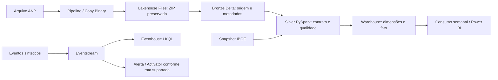

# Fuel Watch BR como preparação para a DP-700

Revisão em 12/11/2026, America/Sao_Paulo. Esta análise orienta o estudo; não registra novos exercícios executados no Fabric.

## Diagnóstico

O projeto e a sequência do roadmap são coerentes com a preparação prática para a DP-700. A evidência está mais desenvolvida em ingestão batch, qualidade, Delta e reprocessamento porque estes são os marcos iniciais. Segurança, ciclo de vida, diagnóstico, desempenho e processamento de eventos já têm etapas futuras definidas. Ainda não terem sido executados não constitui falha de planejamento ou desvio de rota.

O [guia oficial consultado](https://learn.microsoft.com/en-us/credentials/certifications/resources/study-guides/dp-700), atualizado em 30/10/2026, atribui 30–35% a cada um dos três grupos: implementar/gerenciar, ingerir/transformar e monitorar/otimizar. Esses pesos orientam a cobertura ao final da preparação; não exigem distribuir a prática igualmente em cada etapa de um projeto com dependências.

A primeira versão desta análise confundiu cobertura já executada com cobertura planejada e propôs antecipações sem demonstrar necessidade. Após a observação do usuário, essa conclusão foi corrigida. A ordem original permanece adequada; os complementos abaixo devem ser encaixados nos marcos correspondentes ou na revisão final, sem reordenar o projeto automaticamente.

O critério da avaliação é separar: **executado e pertinente**, **previsto em etapa futura**, **mencionado sem exercício explícito** e **possível complemento ao escopo**. Concluir o produto e dominar o conteúdo do exame são acompanhamentos diferentes.

## Material examinado e limites

- Chats **Ler handoff Fuel Watch BR**, **Ler handoff Fuel Watch BR (2)** e **Ler handoff Fuel Watch BR (3)**: páginas recentes e histórico anterior relevante de configuração/execução. Há mensagens herdadas entre chats; elas não representam execuções independentes.
- Chat **Encontrar curso DP-700 em português**, handoff de 11/11, README, contrato, roadmap, guias M02/M03/M04, código PySpark, notebooks, SQL, testes e evidências locais/Fabric.
- Estrutura e trechos da apostila narrativa em português, edição de 06/11/2026, disponível no projeto currículo-vagas-agent. Ela já oferece capítulos para vários assuntos ainda não praticados aqui; esta análise não é uma revisão integral de todas as afirmações da apostila.
- Documentação Microsoft atual e coleção de laboratórios MicrosoftLearning, vinculadas abaixo.

Os resultados Fabric vieram do console fornecido pelo usuário e foram conferidos localmente. Esta revisão não abriu o portal, consultou tabelas remotas ou reexecutou Spark. A suíte local foi executada nesta revisão: **36 testes, sem erros ou falhas**. Isso não transforma o ensaio DuckDB em validação do Warehouse, nem demonstra domínio individual dos assuntos.

## O que estamos construindo

Bronze, Silver e Gold descrevem responsabilidades. A Gold no Warehouse é uma escolha didática para praticar T-SQL e publicação dimensional. Não é uma exigência universal de arquiteturas medalhão. O [guia de escolha de armazenamento](https://learn.microsoft.com/en-us/fabric/fundamentals/decision-guide-data-store) ajuda a comparar alternativas.

O ZIP completo tem 422.418 linhas; o recorte de negócio tem 8.052 coletas de gasolina no RJ, de janeiro a junho de 2026. São 502 postos e 27 municípios observados. A referência IBGE tem 92 municípios: isso não significa que a pesquisa de preços cobriu todos eles.

## Estado comprovado

| Marco | Estado e aprendizado que oferece |
| --- | --- |
| M00 | Fontes perfiladas, contrato e referência local. Aprendizado: conhecer layout, tipos, chaves, unidade, amostra e reconciliação antes de carregar. |
| M01 | Bronze executada duas vezes no Fabric: 422.418 linhas, Delta 0 → 1 e comparação integral das 16 colunas de origem sem diferenças. Copy transporta; notebook interpreta e grava Delta. |
| M02 | IBGE e Silver executados no Fabric. 8.052 coletas, 502 postos, 27 municípios e 26 sinais de preço incomum. Repetição Delta 0 → 1 mantém os 13 campos de negócio e suas multiplicidades. |
| M03 | Laboratório sintético executado no Fabric: 17 cenários, sete publicações, uma repetição, oito rejeições e uma falha antes da promoção, recuperada. Integração ao fluxo oficial ainda aberta. |
| M04 | Quatro scripts T-SQL e núcleo relacional preparados. Ensaio local: 518 versões observadas de posto, 16 transições de bandeira e 656 grupos semanais, sem diferenças na reconciliação. Warehouse ainda não executado. |
| M05–M11 | O roadmap descreve as entregas; não há evidência equivalente de conclusão nesta revisão. |

O experimento M03 terminou com quatro coletas sintéticas, versão ativa 7 e Silver oficial preservada na versão 1. A [evidência M03](../evidence/fabric/versioning/README.md) explicita `official_integration_implemented=false`. A falha foi uma exceção antes da promoção; não foi perda do cluster, disputa entre jobs ou transação distribuída.

A [preparação M04](data-model.md) usa histórico de atributos observados nas coletas. Os intervalos não comprovam a data jurídica da mudança de bandeira. Uma correção antiga pode reconstruir os intervalos e reassociar fatos.

## Conceitos que os resultados ensinam

**Três identificadores diferentes:** o hash identifica os bytes da entrega; a chave de negócio identifica uma coleta; a versão Delta identifica um estado/commit da tabela. Alterar a ordem do CSV pode mudar o hash sem mudar as coletas. Reexecutar pode criar outro commit sem mudar o negócio. Corrigir o preço mantém a chave e altera seu valor.

**Idempotência tem escopo:** na repetição Silver, os metadados de execução e a versão Delta mudam, enquanto os dados de negócio permanecem iguais. No replay do laboratório M03, nem a versão ativa avança. Ambos são comportamentos válidos para os contratos observados.

**Correção histórica não é só inserir novidades:** janeiro pode mudar depois de junho já estar presente. Usar apenas `MAX(data_coleta)` ignora essa alteração. A comparação de snapshots por escopo resolve este contrato de arquivo; não equivale a demonstrar CDC ou toda forma de carga incremental.

**Qualidade não significa apagar extremos:** os 26 preços incomuns permaneceram na Silver. O fixture também comprovou inválidos, duplicatas e conflitos, mesmo quando a fatia oficial não continha esses casos. Contar linhas é necessário, mas a comparação bidirecional preservando multiplicidade oferece uma evidência mais forte.

**Agregação muda a granularidade:** 656 grupos semanais não devem ter a mesma contagem de linhas das 8.052 coletas. Reconciliar a soma de preços e a quantidade de observações. Para combinar grupos, usar soma dos preços dividida pela soma das contagens; não média simples de médias. O resultado não é ponderado pelo volume de combustível vendido.

## Observações para os marcos já planejados

Estes pontos explicam o que observar quando cada marco for executado. Não demonstram necessidade de antecipar etapas ou corrigir implementações que atendem ao escopo atual.

1. **Encerrar a integração M03 com escopo pequeno.** O notebook 04 fixa hash, referência e contagens do M02, e bloqueia outra origem. Isso protege o baseline, mas ainda não é o fluxo oficial de promoção de versões. A próxima mudança deve ligar seleção aprovada, snapshot e proveniência; não remover verificações para qualquer arquivo passar.
2. **Usar as escolhas Spark como material do M09.** `fuelwatch/silver_spark.py` reutiliza o validador Python por UDF e coleta 8.052 preços no driver para o IQR decimal exato. Isso é uma escolha delimitada para esta fatia. No marco de desempenho, pode-se comparar um trecho com funções nativas, join da pequena referência, plano e métricas. Não generalizar `collect()` para volumes arbitrários nem reescrever tudo antecipadamente.
3. **Tratar M04 como ensaio local.** DuckDB verifica regras relacionais, intervalos e reconciliação. Compilação do procedimento, collation, permissões e rollback do Warehouse precisam de execução real. O SQL analytics endpoint permite consultar as tabelas do Lakehouse; ele não oferece DML para modificar esses dados como um Warehouse.
4. **Manter o incidente 430 como exercício de diagnóstico.** A recuperação operacional foi observada; a causa específica não foi comprovada. Inspecionar sessão, job, fila, pool e capacidade antes de afirmar que havia sessões ociosas. A documentação diferencia admissão/filas conforme o modo de execução: [concorrência Spark](https://learn.microsoft.com/en-us/fabric/data-engineering/spark-job-concurrency-and-queueing).
5. **Manter o consumo enxuto.** Uma página Power BI é suficiente para explicar a entrega inicial. Para a DP-700, monitorar refresh e investigar dependências agrega mais ao foco atual que ampliar o acabamento do relatório.

## Aderência do roadmap completo

A avaliação abaixo considera o que está previsto até o encerramento, e não somente a fotografia dos marcos iniciais. O roadmap já estabelece as dependências e permanece sendo a referência de execução.

| Assunto | Onde já está previsto | Avaliação do plano |
| --- | --- | --- |
| Batch, qualidade, duplicatas e reprocessamento | M00–M03 | Aderente e com evidência inicial consistente. A integração oficial é a continuação prevista do M03. |
| Warehouse, dimensional e T-SQL | M04 | Previsto com critérios de reconciliação, intervalos e associação temporal. A execução futura é parte normal do plano. |
| Orquestração, parâmetros e recuperação | M05 | Previsto. O critério de agendamento/evento pode explicitar os dois mecanismos na preparação do laboratório. |
| Dataflow Gen2 | M06 | Previsto com repetição, erro e recuperação. Não há fundamento para classificá-lo como omitido. |
| Segurança e governança | M07 | Previsto com papéis, itens, caminhos de acesso, RLS, mascaramento e rótulos condicionados. Detalhar controles por coluna/objeto/arquivo e endorsement ao preparar a matriz. |
| Git e implantação | M08 | Previsto com sincronização, dev → teste, restauração e validação. Projeto de banco/build é um complemento específico ainda não explicitado como exercício. |
| Monitoramento, diagnóstico e desempenho | M09 e frentes transversais | Previsto, inclusive experimento antes/depois. A própria documentação já diz que esses cuidados começam antes do aceite final. |
| Eventstream, Eventhouse, KQL, janelas e alerta | M10 | Previsto. Structured Streaming em Spark é um mecanismo adicional sem exercício explícito nesse marco. |
| Consumo e modelo semântico | M11 | Previsto com escopo enxuto. Acrescentar a observação de refresh na revisão de operação, sem ampliar o relatório. |

Os complementos pontuais identificados são: exercício de shortcut/mirroring; Structured Streaming/checkpoint; projeto de banco/build; e detalhamento de algumas configurações e controles de governança. Alguns desses assuntos já aparecem na apostila ou nas referências; isso é diferente de haver um aceite prático definido no roadmap. Seu encaixe pode ocorrer na preparação de M06–M10 ou na revisão final, sem alterar as dependências existentes.

Não há evidência nesta análise de que a ordem original esteja prejudicando o aprendizado ou de que os marcos iniciais estejam recebendo esforço excessivo. Sem data de prova ou diagnóstico individual de dificuldades, antecipar segurança, implantação ou tempo real é uma alternativa de organização, não uma correção necessária.

O [guia de escolha de ferramentas](https://learn.microsoft.com/en-us/fabric/fundamentals/decision-guide-pipeline-dataflow-spark) ajuda a comparar Copy, Dataflow, Spark e eventos. A prática deve incluir justificar a escolha diante das restrições de cada caso.

Um [shortcut](https://learn.microsoft.com/en-us/fabric/onelake/onelake-shortcuts) referencia dados; uma cópia preservada fornece independência da entrega; no [database mirroring](https://learn.microsoft.com/en-us/fabric/mirroring/overview), a réplica é mantida por integração gerenciada. Mirroring também possui variantes como metadata mirroring, que usam atalhos; não decorar que toda modalidade necessariamente copia todos os dados.

O [Structured Streaming](https://learn.microsoft.com/en-us/fabric/data-engineering/structured-streaming-overview) exige estudar progresso/checkpoint e estado, além de escrever consultas KQL no outro mecanismo. O marcador de extração batch e o watermark de tolerância a atraso em streaming têm propósitos diferentes.

A [segurança OneLake](https://learn.microsoft.com/en-us/fabric/onelake/security/table-column-row-security) precisa ser verificada por identidade e mecanismo de acesso. Restrições em uma superfície SQL não demonstram, por si, proteção de outro caminho. Papéis elevados também podem invalidar um teste feito para representar um leitor restrito.

Na [integração Git do Warehouse](https://learn.microsoft.com/en-us/fabric/data-warehouse/git-integration), definições são representadas como projeto de banco, com limitações específicas. Ter quatro arquivos `.sql` no repositório não demonstra que esse ciclo de vida foi praticado. Confirmar suporte vigente por item antes do exercício.

## Método por sessão

Ao final do ciclo, conferir a cobertura dos três domínios. A divisão do tempo depende das dificuldades e do conhecimento prévio; os pesos do exame não impõem tempos iguais nem alternância obrigatória entre os assuntos.

Em cada bloco:

1. Explicar em português o problema e prever o resultado antes de executar.
2. Fazer uma alteração pequena pelo próprio usuário: expressão, transformação, consulta, permissão ou parâmetro.
3. Executar e inspecionar a saída; relacionar o resultado ao contrato.
4. Diagnosticar uma falha delimitada, usando a interface e o registro da execução.
5. Explicar quando escolher outra solução e qual hipótese tornaria a escolha atual inadequada.

O agente pode preparar o laboratório e ajudar no diagnóstico. As atividades acima são sugestões para consolidar o conteúdo. Os chats não permitem afirmar que o usuário apenas executa sem compreender, nem concluir seu nível de autonomia. Evitar usar a quantidade de JSONs, commits ou testes como medida de prontidão para a prova.

Para acompanhamento pessoal, registrar por assunto: **não estudado**, **consigo explicar**, **executo com ajuda**, **executo e diagnostico sozinho**. Não atribuir os dois últimos estados automaticamente a partir de execução guiada.

## Perguntas autorais para transformar o projeto em estudo

| Situação | Resposta que precisa saber justificar |
| --- | --- |
| O CSV mudou de ordenação; o hash mudou, mas as coletas são iguais. Inserir tudo novamente? | Não. Identidade dos bytes e identidade do negócio são diferentes; comparar e selecionar a versão conforme o contrato. |
| Junho já foi processado e corrigiram um preço de janeiro. Filtrar data maior que a máxima resolve? | Não para esse contrato. Reprocessar o escopo/snapshot ou usar mecanismo de mudanças adequado à origem. |
| A carga tem o mesmo número de linhas. Está correta? | A contagem não detecta substituições de valores nem compensações entre perdas e duplicatas; comparar conteúdo e multiplicidade. |
| A RLS foi aplicada e o administrador vê tudo. A regra falhou? | Esse teste não representa necessariamente um leitor restrito. Verificar identidade, papel e superfície. |
| O dado precisa ser modificado via T-SQL. Basta usar o endpoint do Lakehouse? | Para DML sobre esses dados, a superfície de leitura do endpoint não atende; escolher Warehouse ou outro mecanismo de escrita suportado conforme a necessidade. |
| A implantação terminou. Os dados e permissões estão necessariamente iguais? | Não inferir. Definições, dados, conexões, permissões e execuções precisam de validação própria conforme o item. |
| Reverter o commit devolve automaticamente os preços anteriores? | Não. Histórico de código e estado publicado dos dados exigem estratégias distintas de recuperação. |
| O notebook usa Spark, então todas as operações são distribuídas? | Não. `collect()` traz os resultados para o driver; uma UDF Python também tem custos diferentes de expressões nativas. |

Essas perguntas são exercícios desta análise, não questões reais ou reprodução de conteúdo do exame.

## Como usar a apostila e os materiais oficiais

Na apostila de 06/11, relacionar os capítulos 2–5 ao caminho Bronze/Silver; 6 e 12 ao M04; 7 ao experimento Spark; 8 à orquestração; 9 a shortcuts/mirroring; 10–11 ao tempo real/KQL; 13–15 a segurança e implantação; 16–17 a diagnóstico/desempenho; 18 ao consumo e refresh. Ler o capítulo correspondente antes do laboratório e voltar aos trechos que o resultado tornou concretos.

Para preencher lacunas sem desenvolver outra aplicação, usar a [coleção oficial MicrosoftLearning de laboratórios Fabric](https://microsoftlearning.github.io/mslearn-fabric/). Ela permite praticar componentes isolados e depois explicar sua aplicação ao Fuel Watch. Conferir requisitos antes de executar; laboratório bloqueado no tenant continua sendo prática pendente.

O guia oficial também aponta para a avaliação de prática atualmente recomendada e avisa sobre a experiência antiga no Learn. Usar a avaliação para descobrir padrões de erro, estudar a justificativa e repetir o assunto na prática. Um resultado isolado ou a contagem de marcos não garante aprovação.

O próximo trabalho concreto continua sendo concluir M03 e seguir para M04, respeitando o estado atual dos chats de execução. M05–M11 permanecem nas posições e dependências já definidas no roadmap. Os complementos de preparação serão associados aos marcos pertinentes, sem tratar etapas futuras previstas como falhas atuais.
