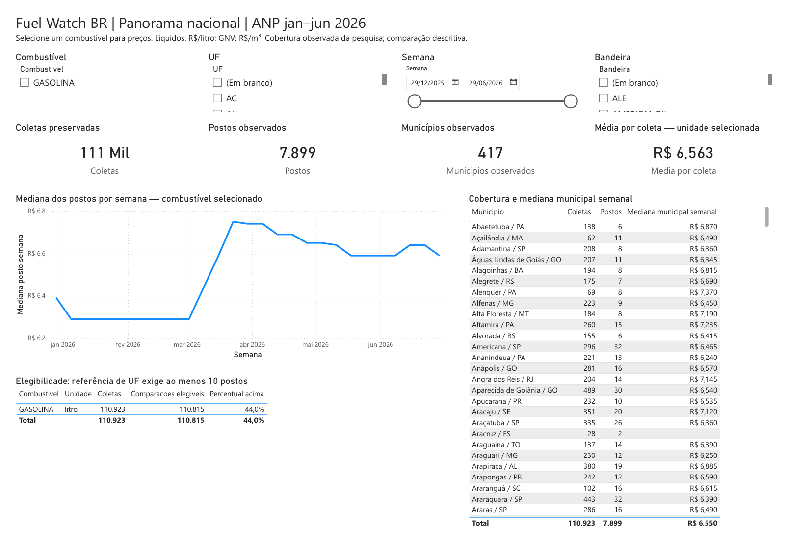
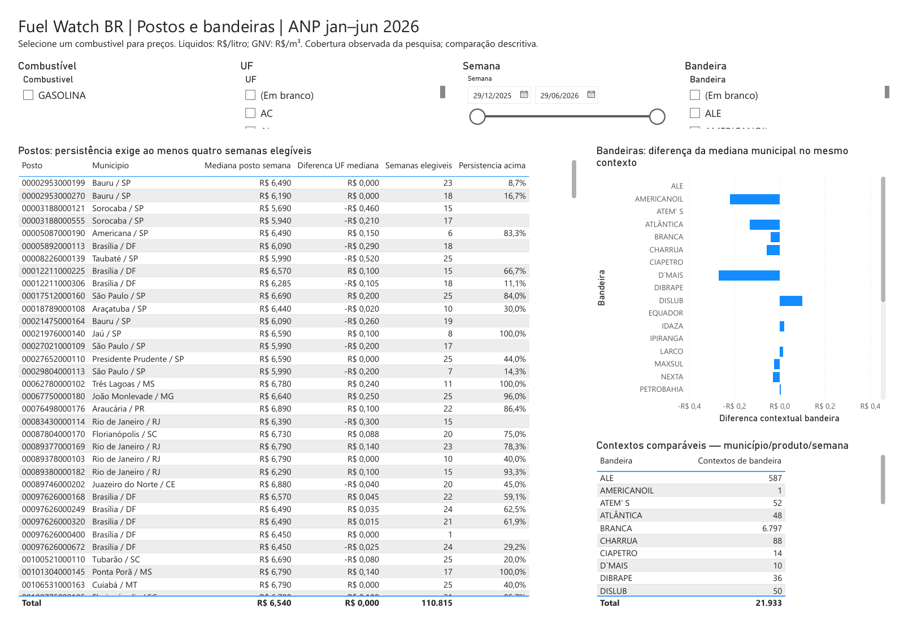

# Fuel Watch BR — apresentação do projeto

[Explorar o atlas](https://victorhob.me/fuelwatch/) · [Código](https://github.com/victorhobdev/fuel-watch-br) · [Relatório histórico](../evidence/phase2/deployment/rebuild-history-report-qa4.pdf)

## Problema e entrega

Transformar arquivos públicos de preços em uma base histórica comparável e auditável: preservar versões, tratar qualidade e atualizar períodos antigos. A solução foi executada no Microsoft Fabric sobre 2.125.547 coletas de janeiro/2024 a junho/2026, com 13.030 postos, 462 municípios, 27 UFs e seis produtos.

## Arquitetura e decisões

ANP → landing identificada por SHA-256 → Bronze Delta → PySpark/Silver → Warehouse Gold dimensional → análises T-SQL → Power BI e snapshot React/MapLibre. IBGE e INMET enriquecem o contexto com regras temporais e geográficas. [Diagrama completo](../README.md#arquitetura).

1. **Versões por conteúdo:** uma correção em arquivo antigo precisa ser detectada mesmo sem aumentar a data máxima da coleta.
2. **Publicação protegida:** troca transacional de fatos, dimensões e identificação da publicação, com falha antes do commit e recuperação verificadas.
3. **Grão explícito:** mediana semanal de cada posto antes da referência regional, um peso por estabelecimento, com critérios mínimos de cobertura.
4. **Comparação histórica:** mesmos CNPJ, produto, município e unidade nos dois períodos, com ausência preservada e variação nominal identificada.

## Resultados visíveis

O relatório histórico de quatro páginas apresenta evolução, posição relativa/bandeiras, postos comuns e contexto. O atlas permite explorar UF/município, combustível e semana, com detalhe de postos localizados e cobertura explícita.

## Verificação e operação

A reconciliação confronta conteúdo tipado, histórico dimensional e agregações com referência independente. Foram executados repetição sem duplicação, correção histórica sintética isolada, recuperação, CI e reconstrução de dados e consumo em workspace vazio.

Um experimento de materialização reduziu a mediana de uma consulta via TDS de 7,375 s para 0,105 s, com resultado idêntico e três amostras por condição. É uma medição daquela consulta; não representa ganho do pipeline inteiro nem economia de capacidade.

## Limites

Projeto pessoal de estudo e portfólio. Preços históricos, nominais e amostrais. Coordenadas usam cadastro ANP de 15/11/2026, com cobertura parcial e status não validado; não reconstituem endereços históricos. Streaming e correções injetadas são laboratórios sintéticos. A revisão de segurança usou implementação/configuração sem segunda identidade. A demonstração estática independe de manter o Fabric ativo.

[Regras analíticas](analytics-contract.md) · [Demonstração técnica](demo.md) · [Reprodução](rebuild-phase2.md) · [Evidências](../evidence/README.md)
